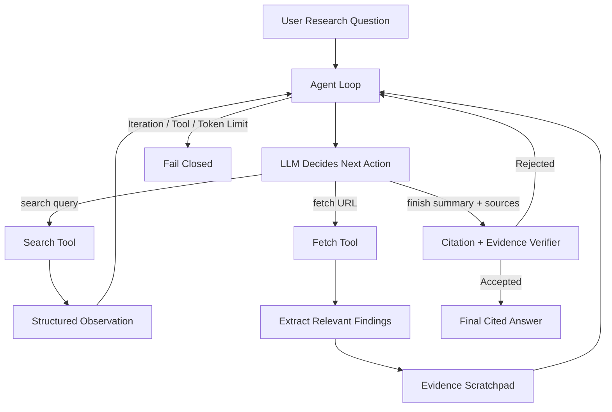

# 🔎 Tool-Using Research Agent

> An autonomous research agent that searches the web, reads sources, builds a compact evidence scratchpad, produces cited answers, and stops when it has enough evidence.

This project implements the agent loop directly in Python rather than relying on an orchestration framework.

The core workflow is:

**Decide → Act → Observe → Update Evidence → Repeat → Finish**

The agent has two external research tools:

- `search(query)` — discovers potentially useful web pages
- `fetch(url)` — retrieves and extracts evidence from a selected page

A separate `finish(summary, sources)` action allows the model to explicitly terminate research once sufficient evidence has been collected.

---

## ✨ Key Features

- Autonomous tool-selection loop
- Web search using Tavily
- Web-page extraction using Trafilatura
- Groq-hosted LLM reasoning
- Structured Pydantic tool schemas
- Compact evidence scratchpad
- Source provenance with `[S1]`, `[S2]`, etc.
- Duplicate search detection
- Duplicate URL detection
- Citation validation
- Semantic evidence verification
- Explicit `finish()` termination
- Iteration and research-call ceilings
- Token/spend protection
- Structured JSONL execution logs
- Graceful tool-failure handling
- 20 automated tests
- 10-question live evaluation suite
- Rich terminal interface

---

## 🧠 Architecture



---

## 🔁 Agent Loop

The project intentionally implements its own orchestration loop instead of using LangChain or LangGraph.

Conceptually:

```python
while within_limits:
    action = model.decide(question, observations, scratchpad)

    if action == "search":
        observation = search(query)

    elif action == "fetch":
        page = fetch(url)
        findings = extract_relevant_findings(page)
        scratchpad.add(findings)

    elif action == "finish":
        validate_citations()
        verify_evidence_support()

        if verification_passes:
            return final_answer

return controlled_failure
```

This makes the complete **decide → act → observe** process visible and explainable.

---

## 🛠 Research Tools

### `search(query)`

Search is used only for **discovery**.

Search-result snippets are not treated as verified evidence and cannot directly become citations.

The agent must fetch a result before information from that page can enter the evidence scratchpad.

### `fetch(url)`

Fetch:

1. validates the URL,
2. performs the HTTP request,
3. follows redirects,
4. verifies the content type,
5. extracts readable HTML content,
6. rejects unusable pages,
7. returns structured output.

Fetched pages are then compressed into a small set of relevant findings before being stored.

This prevents entire web pages from continuously expanding the model context.

---

## 📝 Evidence Scratchpad

Raw fetched pages are deliberately kept out of the long-term reasoning context.

Instead, the system converts useful page content into compact evidence:

```text
[S1]
Title: Example Source
URL: https://example.com

Findings:
- Relevant finding one.
- Relevant finding two.
- Relevant finding three.
```

The scratchpad also tracks:

- executed search queries,
- attempted URLs,
- verified sources,
- source IDs,
- duplicate sources.

This reduces repeated work and limits context growth.

---

## 📚 Citation Model

Only successfully fetched sources can receive source IDs:

```text
[S1]
[S2]
[S3]
```

The final answer references those IDs:

```text
Ocean warming can place thermal stress on corals,
contributing to bleaching events. [S1]
```

Before an answer is accepted, the verifier checks that:

- citations actually appear in the answer,
- cited source IDs exist,
- declared sources exist,
- cited and declared sources match,
- material claims are supported by the collected evidence.

A rejected `finish()` becomes another observation and the research loop can continue.

---

## 🛑 When Does the Agent Stop?

The agent is instructed to finish when:

1. the user's question can be directly answered,
2. material claims are supported by fetched evidence,
3. an authoritative source has been used when reasonably available,
4. important conflicting evidence has been investigated,
5. additional searching is unlikely to materially improve the answer.

The model then explicitly calls:

```text
finish(summary, sources)
```

This is different from merely allowing the model to generate arbitrary final text.

The completion request must pass deterministic citation validation and semantic evidence verification before being accepted.

---

## 🧯 Bounded Execution

The agent is designed to fail closed rather than research indefinitely.

Current operational limits include:

```text
Maximum iterations:      8
Maximum research calls: 12
Maximum model errors:    2
Token budget:       20,000
```

Possible termination states include:

```text
finish
invalid_question
iteration_limit
tool_call_limit
token_limit
model_error
model_error_limit
```

These states make unsuccessful runs observable rather than hiding them behind an apparently successful response.

---

## ⚠️ Real-World Failure Handling

### Repeated search

Normalized search queries are recorded.

If the model requests the same search again, the agent returns an observation telling it that the query has already been executed.

### Repeated fetch

Attempted URLs are tracked separately from successfully stored sources.

This prevents repeatedly fetching the same failing or successful page.

### Invalid tool arguments

Tool inputs are validated using Pydantic schemas.

Malformed calls become structured observations rather than uncontrolled execution.

### Tool/network failure

Timeouts, HTTP errors, invalid content types, extraction failures, and other network problems are returned to the agent as observations.

### Unsupported final answer

A `finish()` request is rejected if its citations are invalid or its material claims are not adequately supported by the scratchpad evidence.

### Failure to stop

External iteration, research-call, model-error, and token limits prevent unlimited execution.

---

## 📂 Project Structure

```text
tool-using-research-agent/
│
├── agent/
│   ├── __init__.py
│   ├── config.py
│   ├── loop.py
│   ├── schemas.py
│   ├── scratchpad.py
│   ├── verifier.py
│   ├── logger.py
│   │
│   └── tools/
│       ├── __init__.py
│       ├── search.py
│       └── fetch.py
│
├── eval/
│   ├── questions.yaml
│   ├── run_eval.py
│   └── reports/
│
├── tests/
│   ├── conftest.py
│   ├── test_schemas.py
│   ├── test_scratchpad.py
│   ├── test_verifier.py
│   └── test_tools.py
│
├── runs/
├── main.py
├── pyproject.toml
├── requirements.txt
├── .env.example
├── .gitignore
└── README.md
```

---

# 🚀 Installation

## 1. Clone the repository

```bash
git clone <your-repository-url>
cd tool-using-research-agent
```

## 2. Create a virtual environment

### Windows

```powershell
python -m venv .venv
.venv\Scripts\Activate.ps1
```

### macOS / Linux

```bash
python3 -m venv .venv
source .venv/bin/activate
```

## 3. Install dependencies

```bash
pip install -r requirements.txt
```

The project can also be installed in editable mode:

```bash
python -m pip install -e .
```

---

## 🔑 Environment Variables

Create:

```text
.env
```

using `.env.example`:

```env
GROQ_API_KEY=
TAVILY_API_KEY=
```

Add your own API keys.

**Never commit `.env` or API keys to Git.**

---

# ▶️ Running the Agent

Run:

```bash
python main.py
```

The CLI asks for a research question:

```text
TOOL-USING RESEARCH AGENT
Search • Read • Verify • Cite • Stop

Enter your research question:
```

Example:

```text
What causes coral bleaching and how does
ocean warming contribute to it?
```

The agent autonomously decides when to:

```text
search
   ↓
inspect results
   ↓
fetch useful sources
   ↓
extract evidence
   ↓
continue researching
   ↓
finish
```

A successful run displays:

- final cited answer,
- verified sources,
- termination reason,
- number of iterations,
- research tool calls,
- token usage,
- run ID,
- execution-log location.

---

# 🧪 Testing

Run:

```bash
python -m pytest -v
```

Current test result:

```text
20 passed in 2.17s
```

### Test coverage areas

| Area | Tests |
|---|---:|
| Tool/input schemas | 5 |
| Scratchpad behavior | 5 |
| URL/tool validation | 5 |
| Citation verification | 5 |
| **Total** | **20** |

All 20 tests passed in the final test run.

---

# 📊 Evaluation

The project includes a live evaluation suite containing **10 research questions** across several domains.

Run:

```bash
python eval/run_eval.py
```

The evaluation measures:

- successful autonomous completion,
- explicit self-stopping,
- citation validity,
- authoritative-source inclusion,
- citation URL reachability,
- iterations,
- research calls,
- token usage.

## Measured Results

The following results are from an actual 10-question evaluation run:

| Metric | Result |
|---|---:|
| Successful runs | **5 / 10** |
| Success rate | **50.0%** |
| Self-stop rate | **50.0%** |
| Valid citation rate | **50.0%** |
| Authoritative source rate | **30.0%** |
| Reachable URL rate | **50.0%** |
| Average iterations | **5.2** |
| Average research calls | **3.9** |
| Average tokens | **15,061** |

The benchmark is intentionally reported without removing failed runs.

### Termination behavior observed

Five questions completed through explicit `finish()`.

The remaining runs were stopped by external safeguards, primarily:

```text
token_limit
iteration_limit
```

This demonstrates an important property of the architecture:

> Failure to self-terminate does not result in unlimited execution.

The outer controller can terminate the run independently of the model.

---

## 📈 What the Evaluation Revealed

The benchmark exposed several areas for improvement.

### 1. Token efficiency

Some research paths required too many reasoning cycles before deciding that sufficient evidence had been collected.

More aggressive evidence sufficiency checks could reduce unnecessary searches and model calls.

### 2. Authoritative-source selection

The measured authoritative-source rate was 30%.

A future version could explicitly rank search results based on source authority, domain type, relevance, recency, and evidence quality before fetching.

### 3. Stopping behavior

The 50% self-stop rate indicates that the explicit stopping mechanism works, but the decision policy can be improved.

A dedicated stopping critic could evaluate:

```text
Do we already have enough evidence to answer?
```

before another research action is allowed.

### 4. Token-ceiling precision

Token usage is measured after model calls return.

Therefore, an individual model call can cause cumulative usage to exceed the configured 20,000-token threshold before the controller terminates the run.

A stricter production implementation could estimate the next request's maximum cost and reserve budget before sending the request.

---

# 📜 Structured Execution Logs

Every research run receives a unique run ID.

Example:

```text
20260926T155823Z-56b2833e
```

Runtime events are written as JSONL under:

```text
runs/
```

Logs capture information such as:

- iteration number,
- selected action,
- tool result,
- verification outcome,
- termination reason,
- token usage.

Raw fetched page content and API secrets are not intentionally written into these execution logs.

This makes the agent's behavior inspectable without exposing credentials.

---

# 🔐 Security and Reliability

Several safeguards are enforced outside the LLM:

- tool allowlisting,
- structured schemas,
- HTTP/HTTPS URL validation,
- redirect handling,
- request timeouts,
- content-type checking,
- duplicate-action prevention,
- iteration ceiling,
- research-call ceiling,
- model-error ceiling,
- token monitoring,
- citation validation,
- evidence verification.

The model therefore does not have unrestricted access to arbitrary Python functions.

---

# 💡 Why No Agent Framework?

The orchestration loop was implemented directly.

For this project, that was intentional.

Using a framework could reduce boilerplate, but implementing the loop manually makes the important agent concepts explicit:

```text
Model decision
      ↓
Schema validation
      ↓
Tool execution
      ↓
Observation
      ↓
Scratchpad update
      ↓
Next decision
```

It also makes iteration limits, duplicate-action handling, termination conditions, and token accounting easier to inspect during an interview.

---

# ⚖️ Search Results vs. Evidence

A deliberate design decision is:

> **Search results discover evidence. They are not evidence themselves.**

A search snippet may be incomplete, stale, or stripped of important context.

Therefore:

```text
search result
     ↓
candidate URL
     ↓
fetch page
     ↓
extract page
     ↓
summarize findings
     ↓
verified scratchpad source
     ↓
citation
```

This gives the citation system clearer provenance.

---

# 🧩 Technology Stack

| Component | Technology |
|---|---|
| Language | Python 3.11 |
| LLM API | Groq |
| Model | `openai/gpt-oss-120b` |
| Search | Tavily Search API |
| HTTP | HTTPX |
| Web extraction | Trafilatura |
| Validation | Pydantic |
| CLI | Rich |
| Configuration | python-dotenv |
| Evaluation data | YAML |
| Testing | pytest |

---

# 🚧 Current Limitations

This is an intermediate research-agent implementation rather than a production search engine.

Current limitations include:

- only HTML/web-page fetching is supported,
- PDFs are not directly extracted,
- JavaScript-heavy pages may not expose useful content,
- live research depends on external APIs and network availability,
- source ranking is relatively lightweight,
- the semantic verifier uses the same LLM provider as the research agent,
- one research action is intentionally executed at a time,
- URL reachability tests can be affected by anti-bot systems,
- token accounting occurs after API calls and can therefore overshoot the configured cumulative ceiling,
- evidence verification reduces unsupported claims but cannot guarantee factual correctness.

These limitations are intentionally documented rather than hidden by the benchmark.

---

# 🔮 Future Improvements

Potential extensions include:

### Independent critic

Use a separate model to judge evidence sufficiency and final-answer grounding.

### Parallel search

Execute independent research branches concurrently while preserving global resource limits.

### Authority-aware ranking

Score candidate sources using domain authority, relevance, freshness, and source type.

### Human-in-the-loop allowlist

Require approval before accessing domains outside an approved set.

### PDF/document research

Extend `fetch()` with dedicated PDF and structured-document extraction.

### Better budget reservation

Estimate the maximum cost of the next LLM request before executing it so that the configured token ceiling becomes strict rather than post-call.

---

# 🎯 Design Goals

The project prioritizes:

**Control over complexity**

**Evidence over search snippets**

**Explicit termination over implicit completion**

**Bounded execution over unlimited autonomy**

**Observable failures over hidden failures**

**Compact evidence over uncontrolled context growth**

---

# 💼 Interview Explanation

A concise explanation of the project:

> I built a research agent with my own orchestration loop rather than using an agent framework. The model can search the web, fetch selected pages, and build a compact evidence scratchpad. Search snippets are treated only as discovery results; only fetched pages can become cited evidence. The agent must explicitly call a finish action, which is checked for citation validity and evidence support before the answer is accepted. I also enforce iteration, tool-call, error, and token limits outside the model so the system fails closed if the model does not stop by itself.

### Why use a scratchpad?

> Full web pages are expensive to keep in the model context. After fetching a page, I extract a small set of relevant findings and store those with the source URL and source ID. Future iterations receive that compact evidence rather than all raw page text.

### What happens if the agent never stops?

> The model is not trusted as the only stopping mechanism. The controller enforces external iteration, research-call, error, and token ceilings. In the live evaluation, some questions did hit those limits, which demonstrated that the outer safeguards work.

---

# 📌 Evaluation Philosophy

The evaluation is not designed only to show successful examples.

It is designed to answer:

1. Does the agent find useful sources?
2. Are final citations tied to real fetched pages?
3. Does the agent stop by itself?
4. Does it prefer authoritative evidence?
5. How much computation does research consume?
6. Does the system terminate safely when autonomous reasoning fails?

That makes failed runs useful engineering evidence rather than results to hide.

---

## Final Status

```text
Agent orchestration       ✓
Search tool               ✓
Fetch tool                ✓
Evidence scratchpad       ✓
Explicit finish           ✓
Citation validation       ✓
Evidence verification     ✓
Bounded execution         ✓
Structured logging        ✓
CLI                       ✓
Unit tests                ✓ 20/20
Live evaluation           ✓ 10 questions
```

---

Built as an intermediate AI Agents project focused on **tool use, evidence grounding, bounded autonomy, context management, and explicit stopping**.